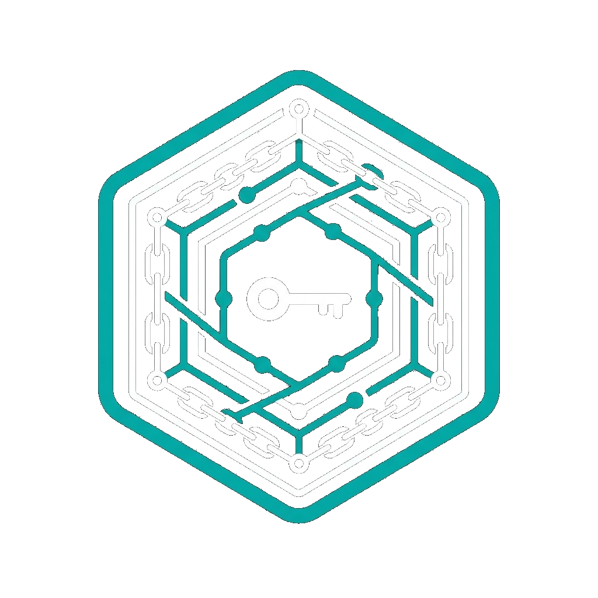

# agentpassport

<p align="center">
  
</p>

[](https://pypi.org/project/agentpassport/)
[](https://www.npmjs.com/package/@agentpassport/core)
[](LICENSE)
[](https://github.com/ceavinrufus/agentpassport/actions/workflows/ci.yml)

agentpassport is a signed delegation chain for agents. Each agent has an Ed25519 `did:key`, and each hop is a JWT recording the scope that agent was granted.

OAuth and MCP authorization decide which client may reach a server. This check sits on top of that. It does not replace the client check.

`Agent.handle` applies the same chain rules as `verify_auth_chain`: the final subject is this agent, each hop's issuer is the previous hop's subject, and scope only narrows. It then checks that the final hop covers the capability. Python `handle` does not consult a revocation registry. `verify_auth_chain` does when you pass `revocation_registry`.

---

## Quickstart

Python first, then the TypeScript SDK. Neither snippet needs a clone of this repo.

### Python

Python 3.11+.

```bash
pip install agentpassport
```

Save as `quickstart.py` and run `python quickstart.py`.

```python
import asyncio

from agentpassport import (
    Agent,
    EventEmitter,
    Intent,
    ScopeError,
    TaskEnvelope,
    generate_keypair,
    sign_delegation,
)

orchestrator_key, _ = generate_keypair()
orchestrator = Agent("orchestrator", private_key=orchestrator_key)
# Agent writes a JSON lifecycle line by default. Silence it for this example.
worker = Agent("worker", emitter=EventEmitter(sinks=[]))
worker.trust_keys({orchestrator.did: orchestrator.public_key})


@worker.capability("query_customers", requires=["read:db:customers"])
async def query_customers(task: TaskEnvelope) -> dict:
    return {"customers": ["ada", "grace"]}


def delegated(scope: list[str]) -> TaskEnvelope:
    token = sign_delegation(
        issuer_private_key=orchestrator_key,
        issuer_did=orchestrator.did,
        subject_did=worker.did,
        scope=scope,
    )
    return TaskEnvelope(intent=Intent(type="query_customers"), auth_chain=[token])


async def main() -> None:
    print(await worker.handle(delegated(["read:db:customers"])))
    try:
        await worker.handle(delegated(["read:db:orders"]))
    except ScopeError as exc:
        print(exc)


asyncio.run(main())
```

```text
{'customers': ['ada', 'grace']}
Capability 'query_customers' requires scope ['read:db:customers'] not granted by the auth chain. Granted: ['read:db:orders']
```

The first call is allowed. The second is signed, and it is rejected because the granted scope is `read:db:orders`.

`pip install agentpassport[otel]` adds the OpenTelemetry sink. The quickstart does not need it.

### TypeScript

Node.js 18+. The package is ESM.

```bash
npm install @agentpassport/core
```

Save as `quickstart.mjs` and run `node quickstart.mjs`. No TypeScript compile step.

```javascript
import { Agent, ScopeError, createTask } from "@agentpassport/core";

const orchestrator = new Agent("orchestrator");
const worker = new Agent("worker");
worker.trustKeys({ [orchestrator.did]: orchestrator.publicKey });

worker.capability(
  "queryCustomers",
  { requires: ["read:db:customers"] },
  async () => ({ customers: ["ada", "grace"] }),
);

const allowed = orchestrator.delegate(
  createTask({ type: "queryCustomers", params: {} }),
  { targetDid: worker.did, scope: ["read:db:customers"] },
);
console.log(await worker.handle(allowed));

const denied = orchestrator.delegate(
  createTask({ type: "queryCustomers", params: {} }),
  { targetDid: worker.did, scope: ["read:db:orders"] },
);
try {
  await worker.handle(denied);
} catch (err) {
  if (err instanceof ScopeError) console.log(err.message);
  else throw err;
}
```

```text
{ customers: [ 'ada', 'grace' ] }
Scope denied for capability "queryCustomers": requires [read:db:customers], missing [read:db:customers]
```

`Agent.delegate` on the TypeScript SDK appends a signed JWT and returns the task. The Python `Agent.delegate` sends that task over HTTP, so the Python quickstart calls `sign_delegation` directly.

---

## What it checks

| Question | OAuth / MCP auth | agentpassport |
|---|---|---|
| May this client reach the server? | Bearer token, when the server requires one | Use the server's OAuth or MCP auth |
| What was this agent in the chain allowed to do? | Client access only | Signed JWT scope, checked before the handler |

MCP authorization for HTTP transports is OAuth 2.1. Support is optional. When a server uses it, the server is an OAuth resource server and a bearer token decides which client may call it. stdio transports are outside that flow. See the [MCP guide](docs/guides/mcp.md).

Frameworks such as LangGraph, CrewAI, and AutoGen do not sign the hop from one agent to the next. A task arrives because the caller was able to send it. agentpassport is the signed record of the scope that caller granted.

## Demo

The snippets above run from a package install. This demo is the cross-SDK walkthrough in the repo: a Python orchestrator delegates to a TypeScript agent.

```bash
git clone https://github.com/ceavinrufus/agentpassport
cd agentpassport
uv run python -m demo.run_demo
```

```
━━━━━━━━━━━━━━━━━━━━━━━━━━━━━━━━━━━━━━━━━━━━━━━━━━━━━━━━
  agentpassport DEMO — Cross-SDK Trust Chain
━━━━━━━━━━━━━━━━━━━━━━━━━━━━━━━━━━━━━━━━━━━━━━━━━━━━━━━━

  Orchestrator  did:key:z6MkskpV…pks2  (Python)
  TS Agent      did:key:z6MkoFDL…3TZf  (TypeScript)

[STEP 1] Python signs delegation JWT
  scope  ['read:db:customers']  ttl 3600s

[STEP 2] Python → TS: queryCustomers → 200 ✅
  Auth chain verified, capability executed

[STEP 3] Python → TS: writeCustomer → 403 🛡️
  ScopeError: requires [write:db:customers], granted [read:db:customers]

[STEP 4] Python revokes delegation mid-scenario
  jti revoked → same request fails → 403 🛡️

[STEP 5] Auth chain trace
  hop 0  jti=d77dd09a…  ✅
    iss  z6MkskpV…  (orchestrator)
    sub  z6MkoFDL…  (ts-agent)
    scope  ['read:db:customers']
    exp  2026-05-12T10:22:48Z
━━━━━━━━━━━━━━━━━━━━━━━━━━━━━━━━━━━━━━━━━━━━━━━━━━━━━━━━
```

**Ownership binding** — domain + wallet binding, offline verification, revocation:

```bash
uv run python -m demo.binding_demo
```

```
━━━━━━━━━━━━━━━━━━━━━━━━━━━━━━━━━━━━━━━━━━━━━━━━━━━━━━━━━━━━
  agentpassport — Ownership Binding Demo
━━━━━━━━━━━━━━━━━━━━━━━━━━━━━━━━━━━━━━━━━━━━━━━━━━━━━━━━━━━━

[STEP 1] Generate agent identity
  DID:               did:key:z6Mkv4kj…
  ✅  Agent identity created

[STEP 2] Bind agent to domain 'agentpassport.fyi'
  ✅  Domain binding created

[STEP 3] Bind agent to Ethereum wallet
  ✅  Wallet binding created

[STEP 4] Assemble binding document
  Document (publish at https://agentpassport.fyi/.well-known/agent-passport.json)

[STEP 5] Verify signatures offline
  ✅  Domain binding signature valid
  ✅  Wallet binding signature valid
  ✅  Tampered signature correctly rejected
  ✅  Expired binding correctly rejected

[STEP 6] Revoke wallet binding
  ✅  Wallet binding is now revoked
  ✅  Domain binding unaffected by wallet revocation

[STEP 7] Final document state
  binding  type=domain [active]
  binding  type=wallet [REVOKED]
━━━━━━━━━━━━━━━━━━━━━━━━━━━━━━━━━━━━━━━━━━━━━━━━━━━━━━━━━━━━
```

### Verify domain ownership — live

agentpassport.fyi publishes its own `/.well-known/agent-passport.json`. With the CLI installed (`pip install agentpassport-cli`):

```bash
$ agentpass identity verify-domain \
    --did did:key:z6Mkh8UwkN88kwynM3mYke8yFXr9ax69jZKv2TCuwG7yPzbw \
    --domain agentpassport.fyi
```

Output:
```
Checking https://agentpassport.fyi/.well-known/agent-passport.json ...
✓ Valid domain binding: 'agentpassport.fyi' claims did:key:z6Mkh8UwkN88kwynM3mYke8yFXr9ax69jZKv2TCuwG7yPzbw
```

## How It Works

### 1. Cryptographic Identity

Every agent has an Ed25519 keypair. Its public key becomes a W3C-standard `did:key:` DID — no central registry, verifiable by anyone.

```python
from agentpassport import Agent

agent = Agent("my-agent")
print(agent.did)  # did:key:z6Mk...
```

### 2. Signed Delegation (Auth Chain)

Trust flows through a chain of signed JWTs. `verify_auth_chain` and `Agent.handle` both reject a hop that grants a wider scope than it was given, a hop whose issuer is not the previous subject, or a final token addressed to a different agent.

```python
from agentpassport import sign_delegation, verify_auth_chain

# Root signs initial grant
token = sign_delegation(
    issuer_private_key=root_priv,
    issuer_did=root_did,
    subject_did=agent.did,
    scope=["read:db:customers"],
    ttl_seconds=3600,
)

# Explicit check. Agent.handle runs these same rules before the handler.
verify_auth_chain(
    auth_chain=[token],
    expected_subject=agent.did,
    known_public_keys={root_did: root_pub},
)
```

### 3. Pre-execution Scope Declaration

Capabilities declare what scope they need. `Agent.handle` checks the auth chain, then that scope, before the handler runs — fail fast, no partial state.

```python
@agent.capability("query_customers", requires=["read:db:customers"])
async def handle(task: TaskEnvelope) -> dict:
    # Only reached if auth chain grants read:db:customers
    return {"customers": [...]}
```

### 4. Revocation

`verify_auth_chain(..., revocation_registry=registry)` returns false after `registry.revoke(jti)`. Nothing is killed.

Python `Agent.handle` does not take a registry, so call `verify_auth_chain` yourself if a revoked token must be rejected. The TypeScript `Agent` checks a registry when you pass `{ revocationRegistry }` to the constructor.

Fragment. `token`, `jti`, `agent`, `issuer_did`, and `issuer_pub` come from a delegation you already signed. They are not defined in this snippet.

```python
from agentpassport import SqliteRevocationRegistry, verify_auth_chain

registry = SqliteRevocationRegistry("revocations.db")
registry.revoke(jti)

verify_auth_chain(
    auth_chain=[token],
    expected_subject=agent.did,
    known_public_keys={issuer_did: issuer_pub},
    revocation_registry=registry,
)  # False
```

## TypeScript SDK

`@agentpassport/core` verifies the same EdDSA JWT the Python SDK signs. The quickstart above is the runnable example. A Python orchestrator can sign a delegation and a TypeScript agent can verify it, with no shared service. The [demo](#demo) runs that path from a clone.

## Scope Format

Scopes are `action:resource` pairs:

```
["read:db:customers", "write:api:stripe", "send:email:notifications"]
```

Both parts together make authorization provable. Action-only (`"read"`) is too loose. Resource-only (`"db:customers"`) is incomplete.

## Packages

| Package | Description |
|---------|-------------|
| [`agentpassport`](https://pypi.org/project/agentpassport/) [](https://pypi.org/project/agentpassport/) | Python SDK — identity, signed delegation, scope checks |
| [`@agentpassport/core`](https://www.npmjs.com/package/@agentpassport/core) [](https://www.npmjs.com/package/@agentpassport/core) | TypeScript SDK (wire-compatible) |
| [`agentpassport-registry`](https://pypi.org/project/agentpassport-registry/) [](https://pypi.org/project/agentpassport-registry/) | Trusted agent registry with signature verification |
| [`agentpassport-adapters`](https://pypi.org/project/agentpassport-adapters/) [](https://pypi.org/project/agentpassport-adapters/) | MCP, REST, and A2A adapters |
| [`agentpassport-cli`](https://pypi.org/project/agentpassport-cli/) [](https://pypi.org/project/agentpassport-cli/) | CLI — keygen, trace viewer |

## CLI

```bash
pip install agentpassport-cli

# Generate a keypair and DID
agentpass identity keygen --alias myagent

# Inspect an auth chain from a trace
agentpass trace show --id trace_abc --file traces.jsonl
```

## Ownership Binding

Agents can prove real-world ownership by publishing a signed binding document at `/.well-known/agent-passport.json`.

```python
from agentpassport import (
    generate_keypair, did_from_public_key,
    bind_domain, bind_wallet, BindingDocument,
    verify_binding_attestation,
)

priv, pub = generate_keypair()
did = did_from_public_key(pub)

# Create bindings
domain_binding = bind_domain(priv[:32], did, "agentpassport.fyi")
wallet_binding = bind_wallet(priv[:32], did, "ethereum", "0xYourAddress")

# Assemble and publish
doc = BindingDocument(version="1")
doc.add(domain_binding)
doc.add(wallet_binding)
print(doc.to_json())  # publish at https://agentpassport.fyi/.well-known/agent-passport.json

# Verify offline
ok = verify_binding_attestation(domain_binding)  # True
```

Or use the CLI:

```bash
agentpass identity bind-domain --alias myagent --domain agentpassport.fyi --output ap.json
agentpass identity bind-wallet --alias myagent --chain ethereum --address 0x... --output ap.json
agentpass identity verify-domain --did <DID> --domain agentpassport.fyi
```

See the [Ownership Binding guide](docs/guides/ownership-binding.md) for the full flow.

## Roadmap

| | Feature | Status |
|---|---|---|
| **Delegation** | Cryptographic agent identity (`did:key:`) | ✅ Done |
| | Signed delegation chain (JWT) | ✅ Done |
| | Scope enforcement + revocation | ✅ Done |
| | Python SDK | ✅ Done |
| | TypeScript SDK | ✅ Done |
| | Cross-language wire compatibility | ✅ Done |
| | MCP middleware adapter | ✅ Done |
| | A2A protocol adapter (inbound + outbound) | ✅ Done |
| **AI Passport** | Identity revocation | ✅ Done |
| | Domain ownership binding | ✅ Done |
| | Wallet ownership binding (chain-agnostic) | ✅ Done |
| | Decentralized agent discovery | 🔜 Planned |
| | Merkle tree revocation (scalable, on-chain ready) | 🔜 Planned |
| | Human-readable ownership declaration | 🔜 Planned |

## Development

```bash
uv sync --all-packages
uv run pytest                          # Python tests (173)
cd packages/agentpassport-ts && npm test     # TypeScript tests (48)
uv run python -m tests.cross-sdk.generate_fixtures && \
  cd tests/cross-sdk && npx tsx generate_ts_fixtures.ts  # cross-SDK fixtures
```

## Contributing

PRs welcome. See [CONTRIBUTING.md](CONTRIBUTING.md) for guidelines.

## License

Apache-2.0